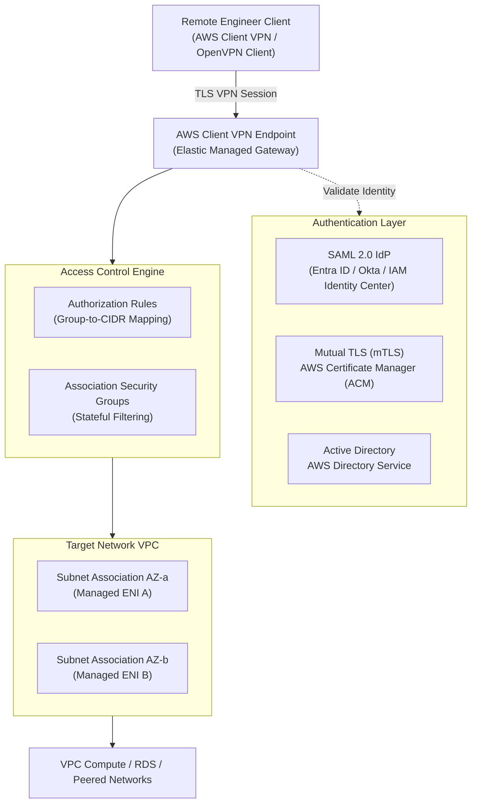

# AWS Client VPN Service Architecture & Endpoints

## Overview
AWS Client VPN is an enterprise-managed, elastic VPN service designed to grant remote engineers secure, TLS-encrypted access to AWS VPC resources, multi-VPC topologies, and hybrid on-premises environments.

---

## Architectural Components

---

## Technical Specifications & Configurable Parameters

### 1. Client CIDR Range
* **CIDR Block Size**: Must be between a `/22` (1,024 IP addresses) and `/12` (1,048,576 IP addresses).
* **Non-Overlapping Requirement**: The client CIDR block **must not overlap** with:
  1. The VPC CIDR associated with the endpoint.
  2. Any peered VPCs, Transit Gateway routes, or on-premises networks.
  3. The local client network CIDR from which users connect (e.g. standard home Wi-Fi `192.168.1.0/24`). A best practice is to assign `172.16.0.0/16` or `100.64.0.0/16` (CGNAT range).
* **Static Allocation**: You cannot modify the client CIDR block after the endpoint is created.

---

### 2. Transport Protocol & Port Selection
AWS Client VPN supports ports **443** and **1194** for both **UDP** and **TCP**:

* **UDP Port 1194 (Default & Recommended)**: Delivers lowest latency and prevents TCP-over-TCP congestion collapse.
* **TCP Port 443**: Best for users connecting from restrictive firewall environments where UDP traffic is blocked.

---

### 3. Split-Tunneling vs Full-Tunneling Configuration
* **Split-Tunnel Enabled (Recommended)**: Only traffic destined for corporate subnets specified in the Client VPN route table is pushed through the tunnel. All standard internet traffic (web browsing, streaming) exits directly through the client's local internet gateway. This dramatically reduces AWS egress bandwidth charges and improves client connection speeds.
* **Split-Tunnel Disabled (Full Tunnel)**: A default route (`0.0.0.0/0`) is pushed to the client. All traffic—including public internet browsing—is routed into AWS and must egress through an AWS NAT Gateway or centralized firewall.

---

### 4. Custom DNS Servers & Route 53 Private Hosted Zones
You can configure up to two custom DNS server IP addresses on the endpoint:

* In typical AWS deployments, specifying the **Amazon-Provided DNS Server (the VPC router IP at `Base VPC CIDR + 2`, e.g. `10.0.0.2`)** allows connected clients to transparently resolve **Amazon Route 53 Private Hosted Zones** (such as `api.internal.corp` or `db.internal.production`).

---

### 5. Session Timeout & Maximum Connection Duration
* By default, Client VPN enforces a maximum connection duration of **24 hours**. After 24 hours, the session terminates and requires the user to re-authenticate with the Identity Provider.
* You can configure session timeout between **8, 10, 12, or 24 hours** to align with internal enterprise security compliance policies.

---

### 6. Self-Service Portal
AWS Client VPN provides an optional AWS-hosted web portal where end users can log in using their corporate SSO credentials to download:

1. The latest pre-configured OpenVPN configuration profile (`.ovpn`).
2. The official AWS Client VPN desktop client application for macOS, Windows, or Linux.

This eliminates manual distribution of configuration files by cloud administrators.

---

## Architectural Constraints & Limits

| Constraint | Limit | Architectural Workaround / Best Practice |
| :--- | :--- | :--- |
| **Max Associated Subnets** | Unlimited subnets, but **only 1 per AZ** | Associate across 2 or 3 AZs for multi-AZ high availability. |
| **VPC Tenancy** | Dedicated Tenancy is **not supported** | Endpoint target VPC must use default (shared) tenancy. |
| **IPv6 Support** | **IPv4 only** | Dual-stack workloads must be addressed via private IPv4. |
| **Max Routes per Endpoint** | Default limit: 50 routes | Aggregate routes using CIDR summarization (e.g., `10.0.0.0/8` or `172.16.0.0/12`). |
