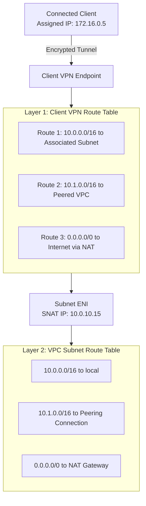

# Route Tables & Packet Routing

## Overview
A route table contains a set of rules (called routes) that determine where network packets from your subnet, gateway, or VPN endpoint are directed. In an AWS Client VPN architecture, routing occurs across two distinct layers:

1. **The Client VPN Endpoint Route Table**: Controls which destination CIDR routes are pushed to connected VPN clients and permitted through the endpoint gateway.
2. **The Associated Subnet VPC Route Table**: Dictates packet forwarding once traffic egresses the Client VPN Network Interface into the VPC.

---

## The Dual-Layer Routing Architecture

!!! note "The Two-Way Routing Requirement"
    For client traffic to reach a destination network (such as a peered VPC or an on-premises server):

    1. You must create a route in the **Client VPN Endpoint Route Table** targeting the destination CIDR.
    2. The **VPC Route Table** of the associated subnet must have a valid route targeting that same CIDR (e.g. via a Transit Gateway, Peering Connection, or Virtual Private Gateway).
    3. An **Authorization Rule** must exist on the Client VPN endpoint granting the client access to that CIDR.

---

## Route Priority: Longest Prefix Match (LPM)

AWS route tables follow the **Longest Prefix Match** algorithm. If multiple routes overlap, the most specific route (the one with the largest subnet mask / prefix length) takes precedence:

| Destination CIDR | Target Gateway | Priority Context |
| :--- | :--- | :--- |
| `10.0.0.0/16` | `local` | VPC-wide communication |
| `10.0.1.0/24` | `eni-12345` | Specific appliance override (more specific than `/16`) |
| `0.0.0.0/0` | `nat-98765` | Default catch-all route for outbound traffic |

---

## Route Table Types in Enterprise AWS

### 1. Main Route Table
The default route table automatically assigned to any subnet that is not explicitly associated with a custom route table. In production enterprise architectures, the main route table should be left empty or restricted to prevent accidental internet exposure of newly created subnets.

### 2. Custom Subnet Route Tables
Dedicated route tables associated explicitly with subnets:

* **Client VPN Association Route Table**: Points local traffic to `local`, internet traffic (`0.0.0.0/0`) to an egress NAT Gateway, and corporate ranges to Transit Gateway (`tgw-xxxx`).
* **Private App Route Table**: Isolated from public gateways.

### 3. Gateway & Edge Association Route Tables
Associated directly with an Internet Gateway (IGW) or Virtual Private Gateway (VGW) to intercept inbound ingress traffic and route it through virtual firewall appliances (e.g., AWS Network Firewall or third-party NGFWs) before reaching workload subnets.

---

## Split-Tunnel vs Full-Tunnel Routing Table Behavior

| Parameter | Split-Tunnel Enabled | Full-Tunnel (Split-Tunnel Disabled) |
| :--- | :--- | :--- |
| **Default Route (`0.0.0.0/0`)** | Retained on client local ISP adapter | Overwritten to point through Client VPN tunnel |
| **Corporate Routes** | Only specified CIDRs (e.g. `10.0.0.0/16`) pushed to client OS | All traffic pushed through Client VPN endpoint |
| **Bandwidth Cost** | Zero AWS egress cost for client web/streaming traffic | High AWS egress cost; all web browsing traverses AWS NAT Gateway |
| **Enterprise Use Case** | Developer workstations & remote engineers | High-security government or financial compliance environments requiring full internet inspection |
