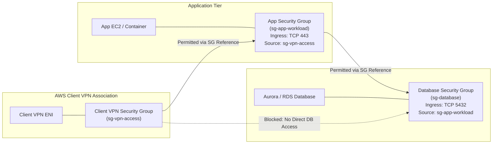

# Security Groups & Stateful Filtering

## Overview
An AWS Security Group acts as a distributed, stateful virtual firewall for Elastic Network Interfaces (ENIs) attached to instances, containers, databases, and managed services. It evaluates traffic at the hypervisor layer, ensuring malicious packets are dropped before reaching the operating system.

---

## Stateful vs Stateless Inspection

Understanding the operational difference between **Security Groups** and **Network ACLs (NACLs)** is foundational to enterprise network security:

| Feature | AWS Security Group | Network Access Control List (NACL) |
| :--- | :--- | :--- |
| **Operating Layer** | ENI / Instance Level | Subnet Boundary Level |
| **State Tracking** | **Stateful**: Return traffic is automatically permitted regardless of inbound rules. | **Stateless**: Inbound and outbound traffic must be explicitly permitted. |
| **Rule Processing** | Evaluates all rules across all attached security groups simultaneously before deciding to allow traffic. | Evaluates numbered rules in sequential order (lowest number first) until a match occurs. |
| **Action Types** | Supports **Allow** rules only (implicit deny all). | Supports both **Allow** and **Deny** rules. |

---

## Security Group Chaining: The Enterprise Best Practice

In an AWS Client VPN deployment, administrators frequently make the mistake of allowing client IP CIDR ranges (e.g. `172.16.0.0/16`) in workload security groups. This is an anti-pattern because Client VPN applies **Source NAT (SNAT)**, and relying on IP ranges violates micro-segmentation principles.

The enterprise standard is **Security Group Chaining (Referencing Security Group IDs)**:

### Why Security Group Chaining is Superior

1. **Zero IP Dependency**: Security group IDs are independent of IP allocations. If the Client CIDR or subnet CIDR changes, no firewall rules need to be updated.
2. **True Least Privilege**: Only instances explicitly tagged with the authorized security group can initiate connections.
3. **Defense Against Lateral Movement**: Even if an unauthorized client establishes a VPN session, they cannot connect directly to databases because the database security group permits connections *only* from the application security group (`sg-app-workload`).

---

## Recommended Rule Configurations

### 1. Client VPN Association Security Group (`sg-vpn-access`)
Applied to the Client VPN target subnet association:

| Direction | Type | Protocol | Port Range | Destination / Source | Purpose |
| :--- | :--- | :--- | :--- | :--- | :--- |
| **Inbound** | None | - | - | - | Default deny; endpoints do not receive unsolicited inbound from VPC. |
| **Outbound** | HTTPS | TCP | 443 | `sg-app-workload` | Permitted outbound egress to application tier. |
| **Outbound** | SSH | TCP | 22 | `sg-bastion-mgmt` | Management access if explicitly needed. |

### 2. Workload Application Security Group (`sg-app-workload`)
Applied to the application EC2 instances or EKS pods:

| Direction | Type | Protocol | Port Range | Source | Purpose |
| :--- | :--- | :--- | :--- | :--- | :--- |
| **Inbound** | HTTPS | TCP | 443 | `sg-vpn-access` | Allows VPN clients secure HTTPS management/web access. |
| **Outbound** | PostgreSQL | TCP | 5432 | `sg-database` | Forward queries to isolated database tier. |