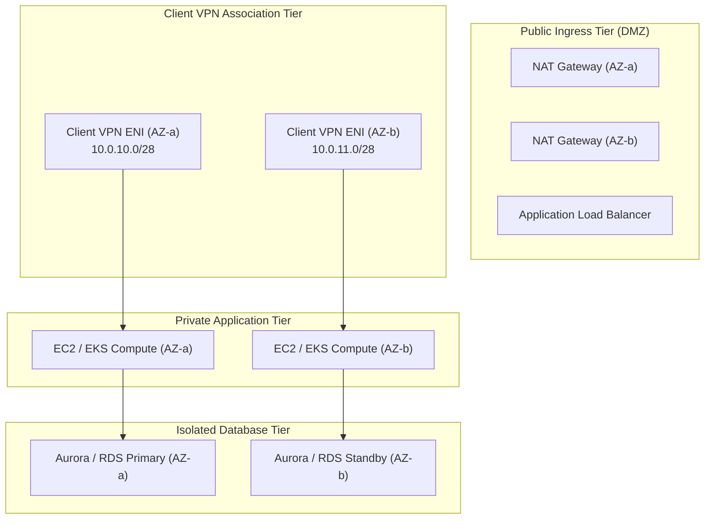

# Amazon VPC Architecture & Design

## Overview
Amazon Virtual Private Cloud (Amazon VPC) provisions a logically isolated virtual network within the AWS Cloud. Designing an enterprise VPC requires careful IP address management (IPAM), multi-tier segmentation, and resilient routing topologies to support secure remote access via AWS Client VPN.

---

## Multi-Tier Subnet Topology

A robust VPC architecture segments network assets into functional tiers, enforcing least-privilege traffic flow between layers:

### Subnet Tiers Breakdown

| Subnet Tier | Routing Characteristics | Workload Purpose |
| :--- | :--- | :--- |
| **Public Subnets** | Default route `0.0.0.0/0` targeting an Internet Gateway (IGW). | NAT Gateways, Public ALBs. No backend compute. |
| **Client VPN Subnets** | Private subnets dedicated exclusively for Client VPN Endpoint associations. | Managed ENIs provisioned by the Client VPN service. |
| **Private App Subnets** | Default route `0.0.0.0/0` targeting NAT Gateways for outbound internet updates. | Microservices, EC2 instances, EKS worker nodes. |
| **Isolated Database Tier** | No route to internet gateways or NAT devices; strictly intra-VPC routing. | RDS, DynamoDB VPC endpoints, Aurora clusters. |

---

## Core Networking Constructs

### CIDR Block Allocation (RFC 1918)
When planning a VPC that interfaces with AWS Client VPN, CIDR allocations must strictly avoid IP overlap:

* **VPC CIDR**: Typically a `/16` block (e.g. `10.0.0.0/16` providing 65,536 addresses).
* **Client VPN Client CIDR**: Must **not overlap** with the VPC CIDR, any peered VPCs, or corporate on-premises subnets (e.g., allocating `172.16.0.0/16` or `10.100.0.0/16` specifically for connecting clients).
* **Minimum Subnet Size**: Target subnets associated with Client VPN require at least a `/27` or `/28` mask to accommodate AWS reserved IPs and managed ENIs.

!!! warning "AWS Reserved IP Addresses in Every Subnet"
    In every AWS subnet, the first four and last IP addresses are reserved by AWS:

    * `10.0.0.0`: Network address.
    * `10.0.0.1`: Reserved by AWS for the VPC router.
    * `10.0.0.2`: Reserved by AWS for DNS (AmazonProvidedDNS).
    * `10.0.0.3`: Reserved by AWS for future use.
    * `10.0.0.255`: Network broadcast address (broadcast is not supported in VPC).

---

### VPC Endpoints & PrivateLink
VPC Endpoints allow instances and VPN clients to privately communicate with supported AWS services (e.g., S3, CloudWatch Logs, Systems Manager) without traversing the public internet.

* **Gateway Endpoints**: Cost-free route table entries directing S3 and DynamoDB traffic privately over the AWS backbone.
* **Interface Endpoints (PrivateLink)**: Elastic Network Interfaces with private IP addresses serving as entry points for AWS services (e.g., `ec2.us-east-1.amazonaws.com` or CloudWatch Logs `logs.us-east-1.amazonaws.com`).
* **Client VPN Relevance**: When Client VPN users are connected, they can resolve and interact with PrivateLink endpoints directly over the VPN tunnel, keeping administrative traffic off the public internet.
