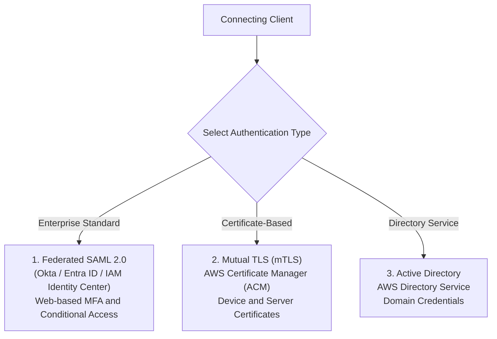
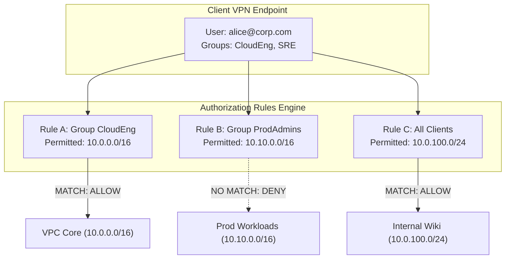

# Authentication & Identity Federation

## Overview
Securing remote ingress requires separating **Authentication** (validating user identity and device integrity) from **Authorization** (enforcing least-privilege access to specific destination networks). AWS Client VPN supports enterprise identity federation coupled with granular, group-based authorization rules.

---

## Authentication Mechanisms

AWS Client VPN supports three enterprise-grade authentication models:

---

### 1. Federated Authentication via SAML 2.0 (Recommended)
SAML 2.0 federation is the gold standard for enterprise Zero-Trust architectures. It delegates authentication to an enterprise Identity Provider (IdP) such as **Microsoft Entra ID (Azure AD)**, **Okta**, or **AWS IAM Identity Center**.

#### Key Benefits
* **Multi-Factor Authentication (MFA)**: Users complete hardware token, FIDO2/WebAuthn, or push notification MFA before establishing the VPN tunnel.
* **Conditional Access Policies**: Enforce device compliance, corporate-managed device checks, and geofencing prior to allowing connections.
* **Single Sign-On (SSO)**: Eliminates separate VPN passwords; engineers authenticate using their corporate single sign-on credentials.
* **Automated Offboarding**: Deactivating an employee in the corporate IdP immediately revokes their ability to authenticate with Client VPN.

#### SAML Integration Flow
1. An IAM SAML Identity Provider is created in AWS containing the IdP's metadata XML.
2. A dedicated Client VPN IAM application is registered within the enterprise IdP (e.g., Okta application or Entra Enterprise Application).
3. The IdP is configured to return the user's Active Directory / IdP **Groups** attribute in the SAML assertion.
4. AWS Client VPN inspects these group assertions to enforce granular network authorization rules.

---

### 2. Mutual Authentication (mTLS)
Mutual authentication utilizes X.509 digital certificates to authenticate both the client device and the AWS Client VPN server.

* **Server Certificate**: Provisioned and stored in **AWS Certificate Manager (ACM)**. Verifies the authenticity of the VPN endpoint to connecting clients.
* **Client Certificate**: Installed on the client workstation.
* **Certificate Revocation Lists (CRL)**: If a client certificate is lost or an employee departs, administrators generate a CRL and upload it to the Client VPN endpoint to block compromised certificates.

---

### 3. Active Directory Authentication
Enables authentication against an Active Directory domain via **AWS Directory Service** (AWS Managed Microsoft AD, Simple AD, or AD Connector pointing to an on-premises domain controller).

* Users authenticate using their standard domain `username` and `password`.
* Supports Active Directory group queries for network authorization.

---

## Network-Based Authorization Rules

AWS Client VPN operates on a strict **Default Deny** security posture. Even after a client successfully authenticates, they **cannot send packets to any subnet or IP address** until an explicit Authorization Rule is configured.

---

## Authorization Rule Structure

Each authorization rule specifies three parameters:

| Field | Configuration Options | Description |
| :--- | :--- | :--- |
| **Destination Network CIDR** | e.g. `10.0.1.0/24`, `10.0.0.0/16`, `0.0.0.0/0` | The specific network block the rule permits access to. |
| **Grant Access To** | Specific Active Directory / SAML Group ID OR All Clients (`*`) | The exact group allowed to traverse the tunnel to this destination CIDR. |
| **Description** | String | Operational documentation explaining the business justification. |

### Enterprise Role-Based Access Control (RBAC) Matrix

| Identity Group | Destination CIDR | Target Resources | Access Rationale |
| :--- | :--- | :--- | :--- |
| `devops-engineers` | `10.0.0.0/16` | All Development & Staging VPC subnets | Infrastructure provisioning and deployment debugging. |
| `data-analysts` | `10.0.50.0/24` | Read-only analytics RDS & Redshift clusters | Query execution without access to compute tiers. |
| `all-employees` | `10.0.200.0/24` | Corporate Intranet & Jira private instances | General internal productivity tools. |
| `contractors` | `10.0.10.45/32` | Specific isolated test environment host | Zero lateral movement allowed. |