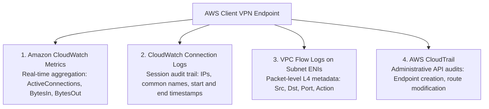
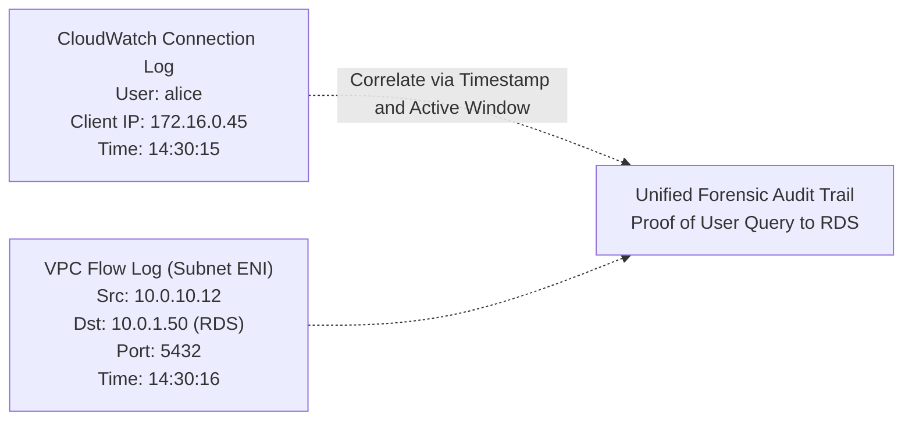

# Observability, Telemetry & Security Forensics

## Overview
Comprehensive observability across remote ingress is mandatory for compliance (SOC 2, ISO 27001, PCI-DSS), capacity planning, and incident response. AWS Client VPN provides telemetry across three complementary layers:



---

## 1. Amazon CloudWatch Metrics

AWS Client VPN publishes quantitative operational metrics to CloudWatch in 5-minute increments under the `AWS/ClientVPN` namespace:

| Metric Name | Unit | Architectural Significance |
| :--- | :--- | :--- |
| **`ActiveConnections`** | Count | Number of concurrently active client sessions. Used for capacity planning and detecting connection anomalies. |
| **`IngressBytes`** | Bytes | Data volume sent from clients to the Client VPN endpoint. Identifies heavy upload or bulk data transfers. |
| **`EgressBytes`** | Bytes | Data volume forwarded from the endpoint back to clients. Monitors database query dumps or large artifact downloads. |
| **`IngressPackets`** | Count | Total packet count ingress into the endpoint. Useful for packet-per-second (PPS) threshold monitoring. |
| **`EgressPackets`** | Count | Total packet count egress back to client workstations. |

---

## Recommended Production CloudWatch Alarms

### Alarm 1: Sudden Active Connection Surge (Credential Compromise Indicator)
* **Namespace**: `AWS/ClientVPN`
* **Metric**: `ActiveConnections`
* **Statistic**: `Maximum`
* **Threshold**: `> 150% of standard baseline`
* **Period**: `5 minutes`
* **Action**: Trigger AWS SNS notification to SecOps Slack channel.

### Alarm 2: Abnormal Ingress/Egress Bandwidth Spike (Data Exfiltration Indicator)
* **Metric**: `EgressBytes`
* **Statistic**: `Sum`
* **Threshold**: `> 25 GB in 15 minutes`
* **Action**: Flag for immediate DLP (Data Loss Prevention) review.

---

## 2. CloudWatch Connection Logging

When Connection Logging is enabled, the endpoint streams real-time JSON log entries for every connection attempt, establishment, reset, and termination:

```json
{
    "connection-log-type": "connection-attempt",
    "connection-attempt-status": "successful",
    "connection-reset-status": "NA",
    "connection-attempt-failure-reason": "NA",
    "connection-id": "cvpn-connection-0123456789abcdef0",
    "client-vpn-endpoint-id": "cvpn-endpoint-0123456789abcdef0",
    "transport-protocol": "udp",
    "connection-start-time": "2026-10-24 14:30:15",
    "connection-last-update-time": "2026-10-24 14:30:15",
    "client-ip": "172.16.0.45",
    "common-name": "alice.developer@mycorp.com",
    "device-type": "mac",
    "device-ip": "198.51.100.24",
    "port": "51240",
    "ingress-bytes": "1428500",
    "egress-bytes": "8942100",
    "ingress-packets": "1240",
    "egress-packets": "6850",
    "connection-end-time": "2026-10-24 18:45:00"
}
```

### Key Forensic Fields Explained
* `common-name`: The authenticated username (from SAML assertion or certificate CN).
* `device-ip`: The public IP address of the user's home or remote internet connection.
* `client-ip`: The private IPv4 address assigned to the client from the VPN Client CIDR block.
* `ingress-bytes` / `egress-bytes`: Total bandwidth consumed during the session.

---

## CloudWatch Logs Insights Forensic Queries

Security teams can run these structured queries in **Amazon CloudWatch Logs Insights** against the Client VPN log group:

### Query 1: Top 10 Remote Users by Data Volume Transferred
```sql
fields @timestamp, `common-name`, `device-ip`, (`ingress-bytes` + `egress-bytes`) / 1048576 as TotalMB
| filter `connection-attempt-status` = "successful"
| stats sum(TotalMB) as TotalBandwidthMB by `common-name`
| sort TotalBandwidthMB desc
| limit 10
```

### Query 2: Failed Connection Attempts & Failure Reasons
```sql
fields @timestamp, `common-name`, `device-ip`, `connection-attempt-failure-reason`
| filter `connection-attempt-status` = "failed"
| stats count(*) as FailureCount by `common-name`, `device-ip`, `connection-attempt-failure-reason`
| sort FailureCount desc
```

### Query 3: Active Sessions Exceeding 8 Hours
```sql
fields @timestamp, `common-name`, `device-ip`, `connection-id`
| filter `connection-attempt-status` = "successful" and isempty(`connection-end-time`)
| sort @timestamp asc
```

---

## 3. Correlating Client VPN with VPC Flow Logs

Because Client VPN applies **Source NAT (SNAT)**, target instances see traffic originating from the **Subnet ENI's IP address** (e.g. `10.0.10.12`).



To reconstruct an incident:
1. Identify the internal target host and timestamp from application or database logs.
2. Search **VPC Flow Logs** for connections originating from the Client VPN Subnet ENI to that host.
3. Query **Client VPN Connection Logs** for active sessions during that exact timestamp to identify the specific engineer (`common-name`) and remote public IP (`device-ip`).
