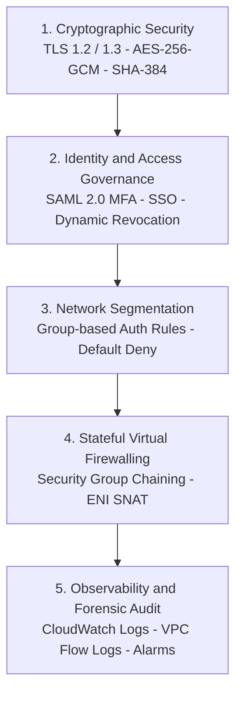
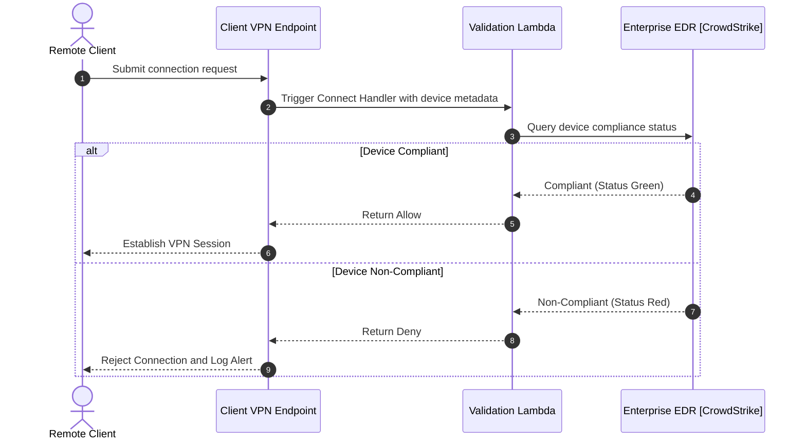

# Security Hardening & Zero-Trust Governance

## Overview
Securing an enterprise remote access gateway requires a **Defense-in-Depth** model spanning cryptographic cipher enforcement, identity governance, endpoint posture validation, session lifecycle controls, and strict IAM administrative boundaries.

---

## Defense-in-Depth Security Layers



---

## Cryptographic Hardening & TLS Configuration

AWS Client VPN establishes encrypted tunnels using Transport Layer Security (TLS). To adhere to modern cybersecurity standards (such as NIST SP 800-52 and CIS AWS Benchmarks):

1. **Protocol Standards**: Enforce TLS 1.2 minimum on all endpoint associations.
2. **Cipher Suites**: AWS Client VPN negotiates industry-standard authenticated encryption ciphers:
   * `ECDHE-RSA-AES256-GCM-SHA384`
   * `ECDHE-RSA-AES128-GCM-SHA256`
   * `DHE-RSA-AES256-GCM-SHA384`
3. **Transport Security**: Avoid using self-signed root certificates in production. Always utilize private or public Certificate Authorities registered within **AWS Certificate Manager (ACM)**.

---

## Certificate Revocation & Emergency Offboarding

When an employee departs or a laptop is reported lost or compromised, administrators must immediately revoke network access.

### 1. Generating and Applying a Certificate Revocation List (CRL)
Using OpenSSL or EasyRSA, administrators generate a CRL and import it to the endpoint:

```bash
# Generate the updated CRL file
openssl ca -gencrl -out crl.pem -config openssl.cnf

# Import the CRL into AWS Client VPN
aws ec2 import-client-vpn-client-certificate-revocation-list \
    --client-vpn-endpoint-id cvpn-endpoint-0123456789abcdef0 \
    --certificate-revocation-list file://crl.pem \
    --region us-east-1
```

Once imported, AWS Client VPN immediately drops any existing sessions utilizing the revoked certificate and blocks future handshake attempts.

### 2. Immediate Session Termination
To forcefully disconnect an active suspicious session without waiting for session expiration:

```bash
# Terminate a specific compromised connection
aws ec2 terminate-client-vpn-connections \
    --client-vpn-endpoint-id cvpn-endpoint-0123456789abcdef0 \
    --connection-id cvpn-connection-0123456789abcdef0 \
    --region us-east-1
```

---

## Client Connect Handler: Device Posture Assessment

For enterprise environments requiring Zero-Trust endpoint posture assessment, AWS Client VPN supports **Client Connect Handlers**:



---

## Least-Privilege IAM Administrative Policies

Administrative access to configure and modify AWS Client VPN resources must be restricted using Attribute-Based Access Control (ABAC) and least-privilege IAM policies.

### 1. Read-Only Auditor Policy
Grants security auditors visibility into routes, endpoints, and active connections without modification rights:

```json
{
    "Version": "2012-10-17",
    "Statement": [
        {
            "Sid": "ClientVPNAuditorReadOnly",
            "Effect": "Allow",
            "Action": [
                "ec2:DescribeClientVpnEndpoints",
                "ec2:DescribeClientVpnTargetNetworks",
                "ec2:DescribeClientVpnConnections",
                "ec2:DescribeClientVpnRoutes",
                "ec2:DescribeClientVpnAuthorizationRules"
            ],
            "Resource": "*"
        }
    ]
}
```

### 2. Scoped Administrator Policy with ABAC Tag Enforcement
Restricts network engineers to managing only endpoints tagged with `Environment = NonProduction`:

```json
{
    "Version": "2012-10-17",
    "Statement": [
        {
            "Sid": "ManageTaggedClientVPNOnly",
            "Effect": "Allow",
            "Action": [
                "ec2:AssociateClientVpnTargetNetwork",
                "ec2:DisassociateClientVpnTargetNetwork",
                "ec2:ApplySecurityGroupsToClientVpnTargetNetwork",
                "ec2:AuthorizeClientVpnIngress",
                "ec2:RevokeClientVpnIngress",
                "ec2:CreateClientVpnRoute",
                "ec2:DeleteClientVpnRoute"
            ],
            "Resource": "arn:aws:ec2:*:*:client-vpn-endpoint/*",
            "Condition": {
                "StringEquals": {
                    "aws:ResourceTag/Environment": "NonProduction"
                }
            }
        }
    ]
}
```

---

## Threat Modeling & Mitigation Matrix

| Threat Vector | Potential Impact | Architecture Mitigation |
| :--- | :--- | :--- |
| **Credential Phishing** | Unauthorized VPN ingress | Mandatory SAML 2.0 with FIDO2 / Hardware MFA; session timeout capped at 10 hours. |
| **Stolen Workstation** | Lateral movement into cloud subnets | Device Posture Check Lambda, Certificate Revocation Lists (CRL), Security Group Chaining. |
| **Rogue Route Injection** | Traffic redirection to malicious IP | IAM ABAC policies restricting `ec2:CreateClientVpnRoute` to approved CI/CD pipelines. |
| **Overlapping IP Collisions** | Routing failures or blackholed traffic | Strict RFC 1918 CIDR reservation policy; client pool assigned to non-standard block (`100.64.0.0/16`). |
