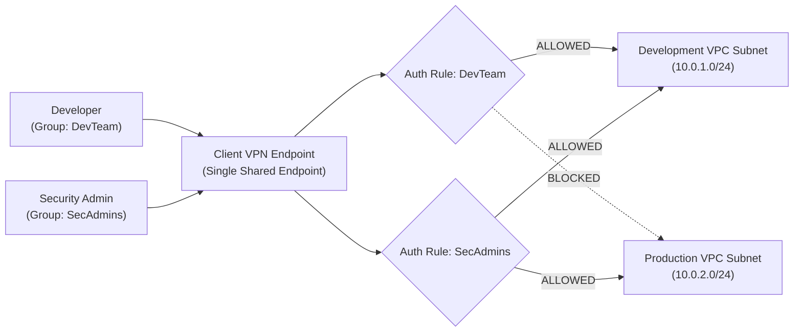

# Enterprise Scenarios & Production Use Cases

## Overview
AWS Client VPN scales across diverse enterprise topologies—from single development VPCs to complex multi-account hub-and-spoke networks connected via AWS Transit Gateway and on-premises datacenters.

This chapter details the **five essential enterprise architecture patterns**, complete with routing matrices, authorization rules, and security controls.

---

## Scenario 1: Secure Access to a Single VPC Workload Tier

The foundational deployment pattern provides remote engineers direct, encrypted access to workloads in a single private VPC without exposing public bastion jump hosts.

### Architecture Highlights
* **Endpoint Association**: Associated with private subnets across two Availability Zones (`us-east-1a` and `us-east-1b`) for high availability.
* **Split Tunnel**: Enabled. Only packets destined for the VPC CIDR (`10.0.0.0/16`) route through the VPN tunnel.
* **DNS Resolution**: The AmazonProvidedDNS (`10.0.0.2`) resolves Route 53 Private Hosted Zones (`*.internal.mycorp`).

### Configuration Matrix

| Layer | Configuration Item | Value |
| :--- | :--- | :--- |
| **Client VPN Route Table** | Destination CIDR | `10.0.0.0/16` targeting Associated Subnet |
| **Client VPN Authorization** | Destination CIDR | `10.0.0.0/16` granted to `EngineeringGroup` |
| **VPC Route Table** | Local Route | `10.0.0.0/16` to `local` |
| **Workload Security Group** | Inbound HTTPS / SSH | Ingress allowed from `sg-client-vpn` (Security Group Chaining) |

---

## Scenario 2: Multi-VPC Access via VPC Peering & Transit Gateway

Enterprises managing multi-account AWS environments often establish a central **Shared Services / Ingress VPC** housing the Client VPN endpoint, granting access to workloads in peered Production and Staging VPCs.

### The Routing Requirement
AWS VPC Peering does **not** support edge-to-edge transitive routing by default. To route client traffic through the Associated Subnet to a peered VPC (`10.1.0.0/16`):

1. The **Client VPN Endpoint Route Table** must have an explicit route for `10.1.0.0/16`.
2. The **VPC Route Table** of the associated subnet must route `10.1.0.0/16` to the Peering Connection ID (`pcx-xxxx`) or Transit Gateway (`tgw-xxxx`).
3. An **Authorization Rule** must grant clients permission to `10.1.0.0/16`.

### Configuration Matrix

| Route Table | Destination CIDR | Target Gateway | Purpose |
| :--- | :--- | :--- | :--- |
| **Client VPN Route Table** | `10.0.0.0/16` | Associated Subnet | Local Ingress VPC routing |
| **Client VPN Route Table** | `10.1.0.0/16` | Associated Subnet | Peered Workload VPC routing |
| **Associated Subnet VPC RT** | `10.1.0.0/16` | `pcx-0123456789abcdef0` | Forwards traffic across VPC peer |
| **Peered Subnet VPC RT** | `10.0.0.0/16` | `pcx-0123456789abcdef0` | Returns traffic back to Ingress VPC ENI |

---

## Scenario 3: Hybrid Cloud Connectivity (On-Premises Data Center)

Remote engineers frequently require simultaneous access to both AWS cloud workloads and legacy on-premises datacenters over a single VPN connection.

### Architecture Highlights
* The Ingress VPC is connected to the on-premises datacenter via an **AWS Direct Connect (DX)** private virtual interface or an **AWS Site-to-Site VPN** connection terminating on a Virtual Private Gateway (VGW) or Transit Gateway (TGW).
* Client traffic destined for `192.168.0.0/16` (on-prem) enters the Client VPN endpoint, undergoes SNAT at the Subnet ENI, and forwards across the Direct Connect / Site-to-Site tunnel.

### Configuration Matrix

| Route Layer | Destination CIDR | Target Gateway | Notes |
| :--- | :--- | :--- | :--- |
| **Client VPN Route** | `192.168.0.0/16` | Associated Subnet | Directs on-premises traffic to the association |
| **VPC Route Table** | `192.168.0.0/16` | `vgw-0123456789` or `tgw-0123456789` | Traverses hybrid cloud link |
| **On-Premises Firewall** | `10.0.10.0/28` (VPN Subnet) | Inbound DX Gateway | Must allow return traffic to the VPN subnet ENI |

---

## Scenario 4: Secure Internet Egress via Centralized NAT Gateway / Firewall

In strict compliance environments (financial services, healthcare), organizations mandate that all remote client internet traffic be inspected, logged, and filtered through centralized egress inspection proxies or the **AWS Network Firewall**.

### Architecture Highlights
* **Split Tunneling is Disabled**: Forces all client traffic (`0.0.0.0/0`) into the Client VPN tunnel.
* Traffic egresses the Client VPN ENI into a private subnet, whose route table points `0.0.0.0/0` to an **AWS NAT Gateway** in a public subnet.
* Public web servers receive traffic originating from the **Elastic IP of the NAT Gateway**, masking user home IPs and enabling IP-whitelisting on third-party SaaS platforms.

### Configuration Matrix

| Component | Setting | Value |
| :--- | :--- | :--- |
| **Client VPN Endpoint** | Split Tunnel | `Disabled` (Full Tunnel Mode) |
| **Client VPN Route Table** | Destination | `0.0.0.0/0` targeting Associated Subnet |
| **Authorization Rule** | Destination | `0.0.0.0/0` granted to all clients or specific groups |
| **Associated Subnet Route Table** | `0.0.0.0/0` | Targets NAT Gateway (`nat-0123456789`) |

---

## Scenario 5: Group-Based Micro-Segmentation (Dev vs. Prod)

A single Client VPN endpoint can securely serve multiple departments with strict micro-segmentation, eliminating the cost of running separate endpoints for dev, staging, and prod:

### Authorization Rules Matrix
1. **Rule 1**: Destination `10.0.1.0/24` to Authorized Group: `DevTeam`
2. **Rule 2**: Destination `10.0.2.0/24` to Authorized Group: `SecAdmins`
3. **Rule 3**: Destination `10.0.200.0/24` (Corporate Docs) to Authorized Group: `*` (All Users)
