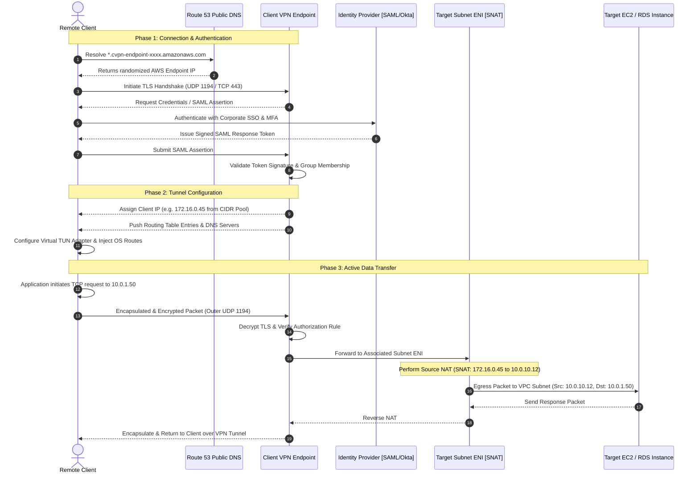

# Packet Flow Lifecycle & Working Mechanism

## Overview
Understanding the exact end-to-end packet flow and session handshake lifecycle of AWS Client VPN is essential for network troubleshooting, latency optimization, and security forensics.

---

## The End-to-End Session Handshake & Packet Lifecycle

---

## Detailed Architectural Phases

### Phase 1: DNS Resolution & Endpoint Randomization
1. The OpenVPN configuration file (`.ovpn`) contains an endpoint DNS name prefixed with an asterisk:
   `*.cvpn-endpoint-0123456789abcdef0.prod.clientvpn.us-east-1.amazonaws.com`
2. When the client establishes a connection, the client software prepends a random alphanumeric string (e.g., `asdf123.cvpn-endpoint-...`).
3. This triggers a unique DNS query to Amazon Route 53, preventing DNS caching and automatically distributing incoming client sessions across AWS's underlying high-availability endpoint fleet.

---

### Phase 2: TLS Handshake & Authentication Verification
1. The client establishes a TLS 1.2 or 1.3 session with the Client VPN endpoint over UDP port 1194 or TCP port 443.
2. If **Federated SAML Authentication** is configured:
   * A local web browser opens automatically on the client machine to complete SSO authentication and MFA with the enterprise IdP (e.g. Okta, Azure AD, Ping Identity).
   * The IdP issues a signed SAML response containing the user's identity and group attributes.
   * The AWS Client VPN endpoint verifies the SAML token against the configured IAM SAML Identity Provider.
3. If **Mutual TLS (mTLS)** is used:
   * The endpoint verifies the client's x509 certificate against the Certificate Authority (CA) imported into AWS Certificate Manager (ACM).

---

### Phase 3: Address Leasing & Route Injection
1. The endpoint leases a unique private IPv4 address from the configured Client CIDR range (e.g., `172.16.0.45` from `172.16.0.0/16`).
2. The endpoint sends configuration parameters back to the client software:
   * **Client IP & Subnet Mask**
   * **Route Table Entries** (e.g., `10.0.0.0/16` for VPC, `10.1.0.0/16` for Peered VPC)
   * **DNS Servers** (e.g., `10.0.0.2` Amazon-Provided DNS)
3. The client OS injects these routes into its local kernel routing table, binding them to the virtual TUN network adapter.

---

### Phase 4: Encapsulation, Egress & Source NAT (SNAT)
1. When an engineer connects to a private internal resource (such as `10.0.1.50:5432`), the client kernel intercepts the packet via the TUN adapter.
2. The payload is encrypted with AES-256-GCM and encapsulated inside an outer UDP or TCP packet destined for the AWS Client VPN endpoint.
3. Upon receipt, the AWS Client VPN endpoint:
   * Decrypts the outer packet.
   * Checks the **Authorization Rules** to confirm whether the user's group is permitted to access `10.0.1.50/32`.
   * Checks the **Endpoint Route Table** to locate the target network association.
4. The packet is sent to the Elastic Network Interface (ENI) in the associated subnet.
5. The ENI performs **Source NAT (SNAT)**, rewriting the source IP address from `172.16.0.45` to the ENI's private IP (`10.0.10.12`).
6. The packet traverses the VPC switching fabric, adheres to VPC route tables, passes through destination Security Groups, and reaches the target instance.