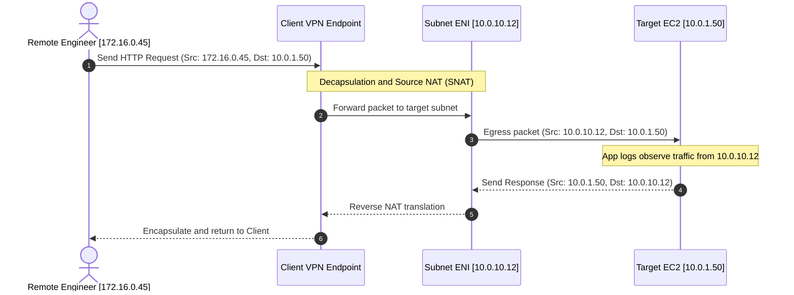

# Elastic Network Interfaces (ENI) & SNAT Architecture

## Overview
An Elastic Network Interface (ENI) is a logical networking component in an Amazon Virtual Private Cloud (VPC) that represents a virtual network interface card (vNIC). It provides IP addressing, MAC addressing, security group attachment, and network traffic control.

---

## The AWS Client VPN Managed ENI

When you associate a subnet with an AWS Client VPN endpoint, AWS automatically provisions and manages an **Elastic Network Interface** within that target subnet on your behalf.

---

## Critical Architectural Implications of Client VPN ENIs

### 1. Source Network Address Translation (SNAT)
As demonstrated above, traffic exiting the Client VPN endpoint into your VPC undergoes **Source NAT (SNAT)**:

* The source IP address from the client CIDR pool (`172.16.0.0/16`) is **translated to the private IP address of the Client VPN network interface** in the associated subnet.
* **Security & Firewall Impact**: Workload instances (web servers, databases) will **never** receive packets with the client's original `172.16.x.x` address. They only observe traffic originating from the Subnet ENI's IP address (`10.0.10.12`).
* **Forensic Audit Consequence**: Application access logs (such as Nginx or PostgreSQL logs) will show all client requests originating from the same ENI IP address. To audit which individual developer initiated a specific connection, security teams must correlate application timestamps with **AWS Client VPN Connection Logs** in CloudWatch Logs.

---

### 2. ENI Provisioning & Lifecycle

* **Automatic Scaling**: As concurrent VPN connections scale up, AWS manages the underlying throughput capacity of the endpoint network interfaces.
* **Security Group Binding**: You can associate up to 5 security groups directly with the Client VPN target network association. These security groups govern all traffic egressing from the managed ENIs.
* **Immutability**: You cannot detach, modify, or delete the managed Client VPN ENI directly from the EC2 console. The ENI is automatically decommissioned only when the subnet association is disassociated via the Client VPN management API.

---

## Enterprise Use Cases for Multiple Network Interfaces (Dual-Homing)

Beyond Client VPN endpoints, standard EC2 compute workloads frequently utilize multiple ENIs for network isolation:

| Architecture Pattern | Description | Security Benefit |
| :--- | :--- | :--- |
| **Management Network Isolation** | Primary ENI (`eth0`) handles public application traffic; secondary ENI (`eth1`) connects to a private management subnet accessible only via Client VPN. | Isolates SSH/management traffic from external public data flows. |
| **Dual-Homed Security Appliances** | Virtual firewall appliances (e.g. pfSense, Palo Alto VM-Series) with an untrusted interface in a public subnet and a trusted interface in a private subnet. | Enables stateful inline packet inspection before traffic enters internal VPC subnets. |
| **Distinct Subnet Workload Roles** | An instance simultaneously connected to a frontend web subnet and an isolated backend messaging subnet. | Enforces micro-segmentation without routing through intermediate routers. |