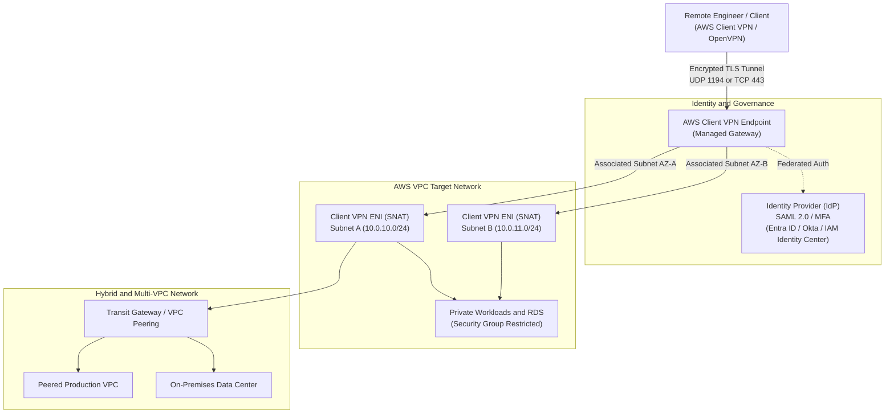

# Executive Architecture Overview

## Architectural Challenge
In modern enterprise environments, engineering teams require secure, seamless access to sensitive cloud workloads spanning development, staging, and production environments across multiple AWS Virtual Private Clouds (VPCs) and on-premises datacenters.

Traditionally, organizations relied on **Bastion Jump Hosts** or **Self-Managed EC2 VPN Concentrators**. However, these legacy architectures introduce critical enterprise liabilities:

!!! warning "Vulnerabilities of Legacy Ingress Models"
    * **Public Attack Surface**: Publicly exposed SSH (port 22) or RDP (port 3389) endpoints invite brute-force scanning, port probes, and zero-day exploitation.
    * **Credential Leakage & Stale Keys**: Static SSH private keys or shared VPN certificate files distributed across developer laptops cannot be cleanly or immediately revoked upon employee offboarding.
    * **Unrestricted Lateral Movement**: Once perimeter ingress is breached, an attacker frequently gains broad Layer 3 access to adjacent subnets and resources due to a lack of identity-aware network segmentation.
    * **Operational Overhead & Scaling Bottlenecks**: Self-hosted OpenVPN servers on EC2 require manual OS patching, licensing, manual failover clustering, and bandwidth resizing.

---

## Zero-Trust Solution

**AWS Client VPN** delivers an elastic, fully managed, client-based VPN service based on the open-source **OpenVPN** protocol. It replaces fragmented jump hosts with a unified, identity-aware ingress architecture.

### Value Proposition Matrix

| Architectural Pillar | Legacy Jump Host / EC2 VPN | AWS Client VPN Managed Service |
| :--- | :--- | :--- |
| **High Availability** | Manual active/passive clustering; single point of failure | Automated multi-AZ elasticity backed by AWS infrastructure |
| **Authentication** | Static SSH keys or local Linux users | Federated SAML 2.0 (Okta, Microsoft Entra ID, IAM Identity Center) with MFA |
| **Authorization** | All-or-nothing subnet routing | Granular, group-based network ingress rules mapped to Directory groups |
| **Traffic Path** | Full tunnel or complex manual iptables routing | Configurable split-tunneling; non-corporate traffic bypasses AWS |
| **Logging & Audit** | Local `/var/log/secure` logs requiring custom forwarders | Native Amazon CloudWatch connection logging and CloudTrail audit trails |

---

## Core Network Capabilities

### Key Design Tenets

1. **Identity-Driven Perimeter**: User authentication happens prior to network packet forwarding. Unauthenticated packets are dropped at the edge.
2. **Stateful Security Group Chaining**: Traffic leaving the Client VPN endpoint carries an AWS Security Group ID. Target applications accept traffic *only* from the Client VPN security group, completely ignoring arbitrary IP ranges.
3. **Split-Tunnel Optimization**: Corporate traffic is selectively pushed over the secure tunnel, while standard internet traffic (video streaming, general web browsing) remains on the client's local internet breakout, preserving AWS egress bandwidth and minimizing latency.
4. **Deterministic Observability**: Every connection attempt, termination, source IP, duration, and data volume is captured natively in Amazon CloudWatch Logs for compliance and forensics.

---

## Documentation Roadmap

To thoroughly evaluate and implement this architecture, review the structured sections in this guide:

* [**Network Fundamentals**](aws-vpc.md): Deep-dive into VPC design, CIDR allocation, Subnet sizing, Route Tables, and Elastic Network Interfaces (ENI).
* [**AWS Client VPN Core**](aws-cvpn.md): Endpoint specifications, packet flow lifecycle, SAML 2.0 federated identity, and security hardening.
* [**Enterprise Use Cases**](cvpn-use-case.md): Architectural topologies covering Single VPC, Multi-VPC Peering, Transit Gateway, and Hybrid Cloud.
* [**Operations & Governance**](cvpn-monitoring.md): Observability metrics, log forensics, and architecture FAQs.
