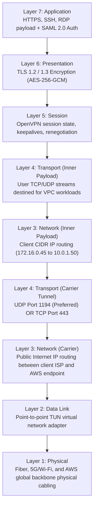
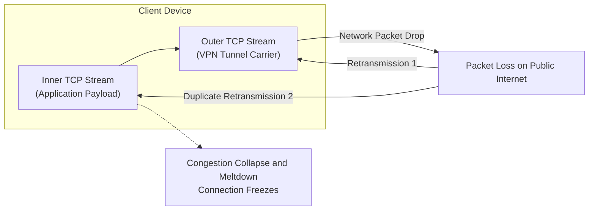

# Applied OSI Model in AWS Client VPN

## Overview
The Open Systems Interconnection (OSI) reference model characterizes computing and telecommunication functions into seven abstract layers. Rather than treating this purely as academic theory, an enterprise network architect must understand how **AWS Client VPN operates across each specific layer of the OSI model**.

---

## AWS Client VPN Layer-by-Layer Mapping

AWS Client VPN is an implementation of the **OpenVPN** protocol operating across the OSI stack:

---

## Layer 3 TUN vs Layer 2 TAP Architecture

OpenVPN and VPN protocols typically support two virtual network driver modes:

| Dimension | Layer 3: TUN (Routing) | Layer 2: TAP (Bridging) |
| :--- | :--- | :--- |
| **Operating Layer** | **Network Layer (IP packets)** | **Data Link Layer (Ethernet frames)** |
| **AWS Client VPN Support** | **Standard (Exclusively supported)** | Prohibited / Not supported |
| **Broadcast / Multicast** | Does not forward broadcast (efficient) | Forwards all broadcasts (high network noise) |
| **Payload Overhead** | Lower overhead (only raw IP packets) | Higher overhead (includes full 14-byte Ethernet headers) |
| **Enterprise Fit** | Ideal for IP routing across VPCs, peered networks, and on-premises | Used primarily for legacy protocols requiring raw Ethernet bridging |

!!! note "TUN Adapter Behavior"
    AWS Client VPN operates in **Layer 3 TUN mode**. Clients install a virtual TUN adapter on their operating system. When the VPN connection is established, the OS routing table redirects packets matching the target network routes into the TUN device, where they are encapsulated and encrypted.

---

## The Layer 4 Transport Dilemma: UDP 1194 vs TCP 443

AWS Client VPN supports both **UDP** and **TCP** as the carrier protocol on ports 443 and 1194.

### Why UDP 1194 is Strongly Recommended (Avoiding TCP-in-TCP Meltdown)
When users run TCP-based applications (such as HTTPS, SSH, database queries, or git clones) over a VPN tunnel that is *itself* running on TCP (e.g. TCP port 443), an architectural phenomenon known as **TCP-over-TCP meltdown** can occur:

1. If a packet is dropped on the public internet, the **outer TCP layer** pauses and retransmits the lost packet.
2. Simultaneously, the **inner application TCP layer** detects missing packets and begins its own independent retransmissions and exponential backoff timers.
3. The two independent TCP sliding window algorithms fight each other, creating a queue backlog that leads to catastrophic throughput drops and dropped connections.
4. **Resolution**: Running over **UDP port 1194** avoids this conflict completely because UDP provides connectionless transport, allowing the inner application's TCP stack to handle retransmissions cleanly without double-buffering.

### When to Use TCP 443
The only valid scenario for TCP 443 is when remote engineers are connecting from restrictive guest Wi-Fi networks (hotels, airports, or client corporate networks) that block outbound UDP traffic entirely. In that case, TCP 443 masquerades as standard outbound HTTPS traffic.