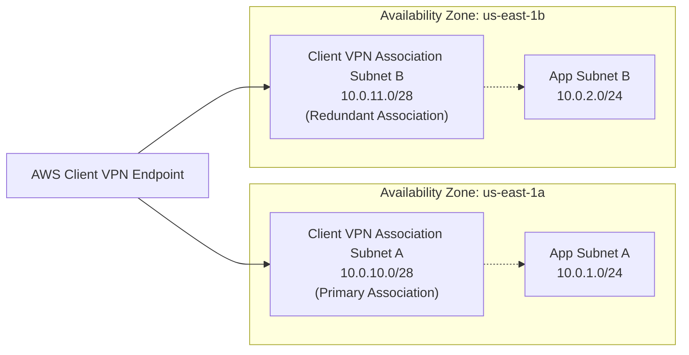

# Subnets & CIDR Planning

## Overview
A subnet is a distinct IP address range within an Amazon Virtual Private Cloud (VPC). Subnets enable network engineers to logically partition cloud infrastructure across physical Availability Zones (AZs), ensuring high availability, fault isolation, and precise traffic segmentation.

---

## Subnet Architecture for AWS Client VPN

When configuring AWS Client VPN, subnets serve as the **Target Networks** where the Client VPN endpoint attaches managed Elastic Network Interfaces (ENIs). Understanding subnet constraints is essential to preventing production outages.

---

## Technical Rules & Constraints for Client VPN Subnets

### 1. Same VPC Restriction
All subnets associated with a given Client VPN endpoint **must reside within the same VPC**. You cannot associate Subnet A from `vpc-1` and Subnet B from `vpc-2` to the same endpoint. Multi-VPC connectivity is achieved via VPC Peering or AWS Transit Gateway.

### 2. One Subnet per Availability Zone
AWS Client VPN enforces a strict limitation: **You can associate only one subnet per Availability Zone**. 

* Allowed: Subnet in `us-east-1a` + Subnet in `us-east-1b`
* Prohibited: Two distinct subnets both located in `us-east-1a`

### 3. Sizing & IP Address Allocation
AWS requires target subnets to have a minimum CIDR block size of `/27` (recommended) or `/28`:

* A `/28` subnet provides 16 IP addresses.
* AWS reserves 5 addresses (`.0`, `.1`, `.2`, `.3`, `.255`), leaving 11 usable IP addresses.
* Client VPN creates managed network interfaces in the target subnet to handle client traffic. Having sufficient headroom prevents ENI allocation failures during traffic spikes or scaling events.

!!! warning "Subnet IP Exhaustion Risk"
    If you associate a heavily utilized existing application subnet (e.g., where EKS pods or Lambda functions consume almost all private IPs), Client VPN will fail to provision its required scaling ENIs, leading to failed client connection attempts.
    
    **Best Practice:** Provision dedicated, isolated subnets specifically for Client VPN associations.

---

## Sizing Comparison Table

| Metric | Subnet /28 | Subnet /27 | Subnet /24 |
| :--- | :--- | :--- | :--- |
| **Total IPs** | 16 | 32 | 256 |
| **AWS Reserved** | 5 | 5 | 5 |
| **Usable IPs** | 11 | 27 | 251 |
| **Suitability for VPN** | Suitable for small deployments | **Recommended for Production** | Over-provisioned (unless shared with compute) |

---

## High Availability & Multi-AZ Resilience

By associating subnets across at least two Availability Zones:

1. **Automated Redundancy**: If a single Availability Zone experiences a hardware degradation or service disruption, the Client VPN service automatically routes client traffic through the healthy AZ association without administrative intervention.
2. **Bandwidth Scaling**: Associating multiple subnets distributes the throughput load across multiple AWS-managed network interfaces, preventing bottlenecking on a single physical link.
